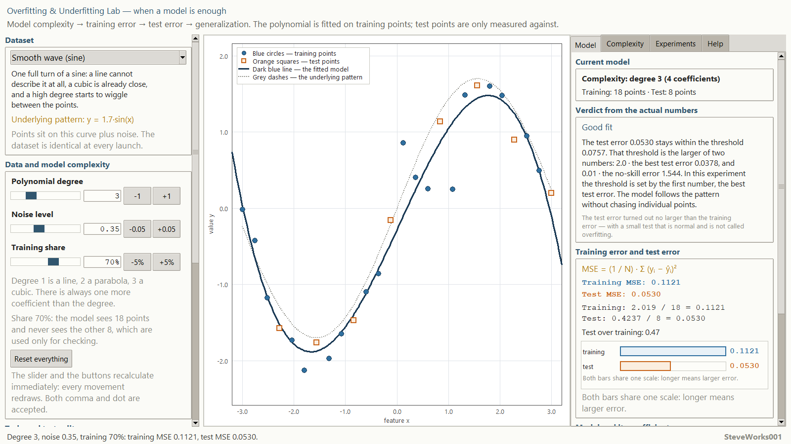
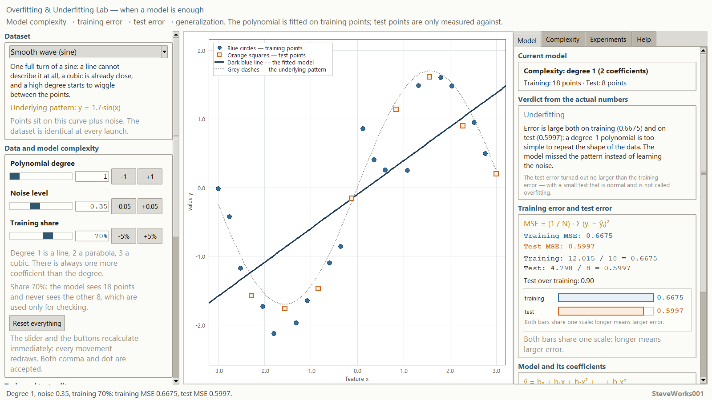
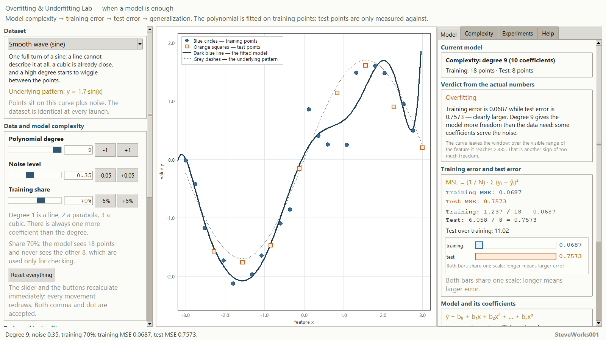
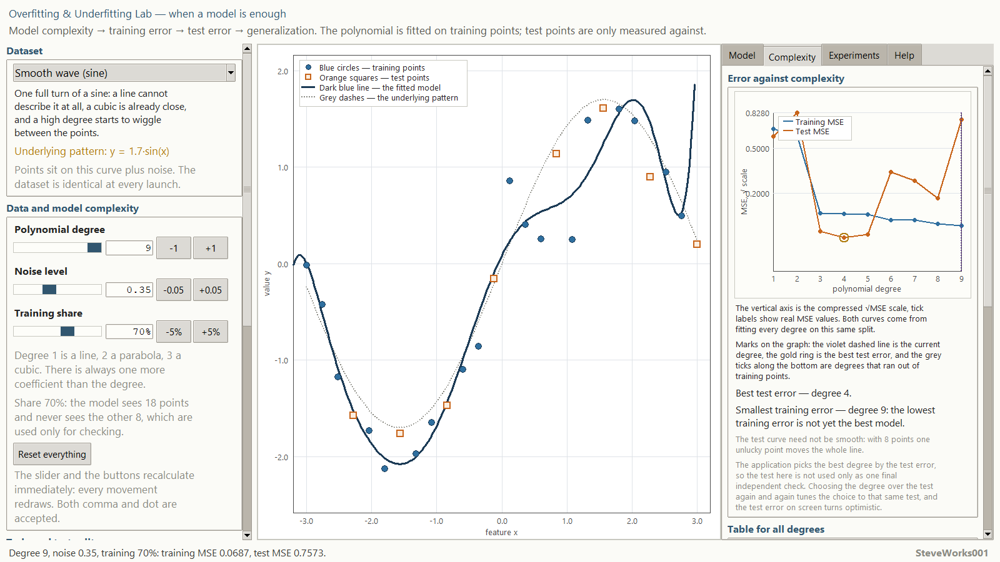
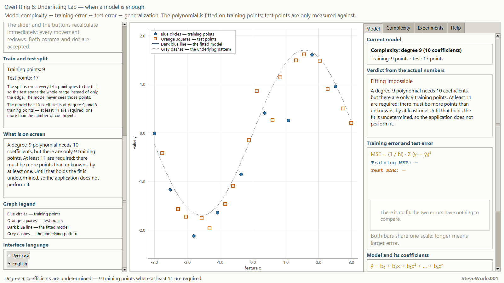
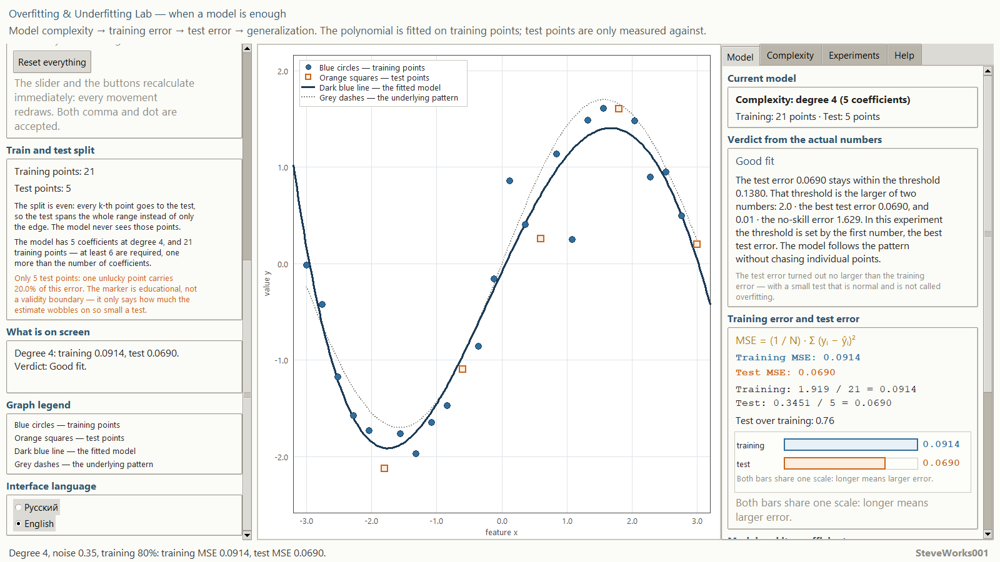
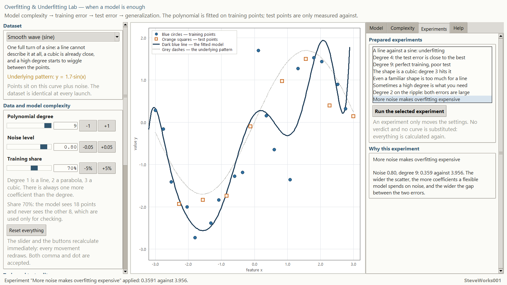
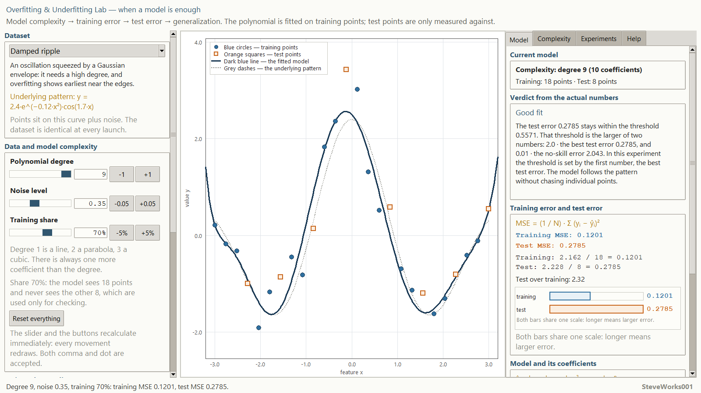
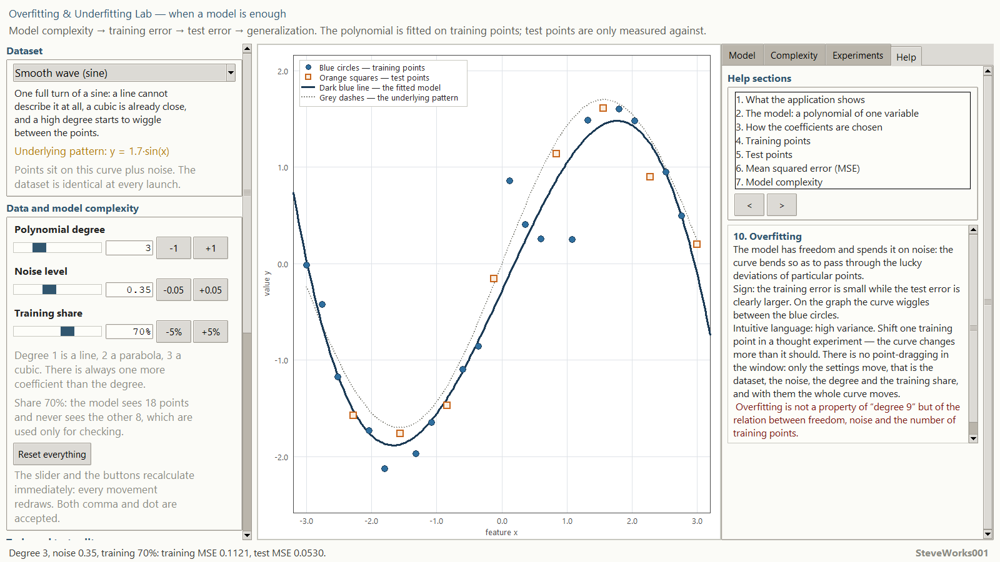
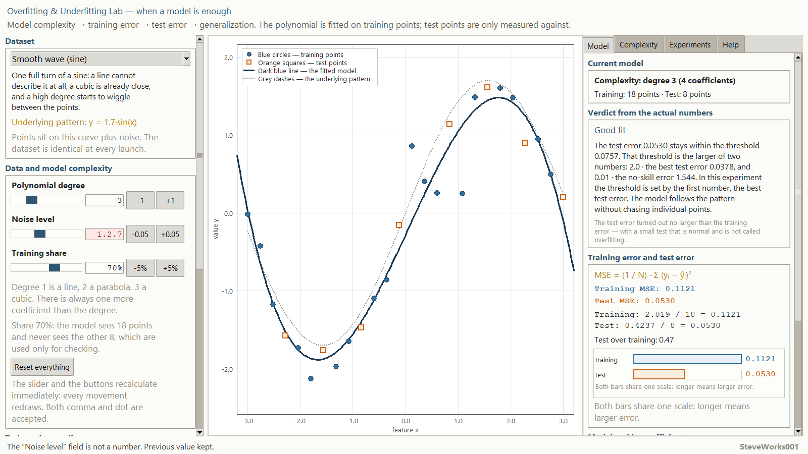

# Overfitting & Underfitting Lab — an educational simulator of overfitting and underfitting

Project 10 of 13 in the educational neural-network simulator series.
A single-file Python and Tkinter application: standard library only, no external
packages, no network and no dependency installation.
It demonstrates one chain through a live experiment: **model complexity →
training error → test error → generalization**. Those are exactly the four links
printed under the window title. This is not a machine-learning library and not a
neural-network training system.

The application opens in a known state: the "Smooth wave (sine)" dataset, degree 3,
noise level 0.35 and a 70% training share. The status line says it in words:
`Dataset “Smooth wave (sine)”, degree 3, noise 0.35, training 70%. Training points
18, test points 8.` That starting position is already a worked example of a good
fit — training MSE 0.1121 against test MSE 0.0530, verdict "Good fit". The "Reset
everything" button returns to exactly this state.

---

## Purpose

The simulator answers one question: **when a model is enough, when it is too
confined, and when it starts memorising noise**. The same dataset, the same
model — a polynomial — and you change only three things: its degree, the noise
level and the training share. On screen you see the training error fall almost
always, while the test error first falls and then rises.

The main chain the whole interface is built on:

**model complexity → training MSE → test MSE → a labelled regime →
generalization**

In the window the chain is shorter — four links, without "a labelled regime": the
regime label is a device of the interface, not a part of the phenomenon, and the
window subtitle lists four links. The fifth link is added here deliberately: the
text below explains in detail how the application derives the label from the
computed errors, and without that step the chain stops at two metrics.

There is a single model everywhere: the points, the curve, both errors, the
comparison bars, the table over degrees and the complexity-vs-error chart all
come from the very same split and the very same least-squares solution. No
decorative lines and no pre-cooked verdicts — the application labels the regime
from the computed errors, not from the value of the degree.

### What this project does not contain

The earlier projects of the series show training and its steps. Training in that
sense is absent here, on purpose:

- no gradient descent, no epochs, no iterative refinement of coefficients — the
  polynomial is found by one least-squares solve;
- no regularization (L1, L2) and no way to "rescue" an overly flexible model;
- no cross-validation, no bootstrap, no repeats over different splits;
- no ensembles, no neural networks, no nonlinear model families;
- no classification and none of its metrics: this is regression, the answer is a
  number;
- no multi-dimensional features: there is exactly one feature, which is why the
  whole experiment fits on a plane;
- no real datasets, no data download and no external libraries.

All the attention goes to one central comparison: what happens to the two errors
when the model has too little freedom and when it has too much.

## Learning goals

- Understand that model complexity is not an abstraction but the number of
  coefficients a model can spend on the data.
- Walk the whole chain: complexity → training error → test error → a verdict
  about generalization.
- Tell training points from test points and understand why the test ones take no
  part in the fit in any form.
- Understand that a low training error says nothing on its own: it must always be
  compared with the error on data the model has never seen.
- See all three regimes on the same dataset: underfitting, a good fit and
  overfitting.
- Understand that overfitting is not "a high degree" but a combination of high
  model freedom and noise in the data.
- Understand that underfitting is not "a low degree" but an error that is large
  on both sides.
- Learn to read the complexity-vs-error curve and see that the minimum test
  error is a property of a particular dataset, not a number known in advance.
- Understand that there is no "right" degree: the best degree depends on the
  shape of the data, the noise level and the size of the training set.
- Get an intuitive feel for bias and variance — without formulas and without
  proofs.
- Understand when a solve legitimately refuses: when the training points do not
  outnumber the coefficients — a margin of at least one point is required — and
  when the solution stops being stable.

## Mathematics: a polynomial and two errors

| Concept | Notation |
|---|---|
| **Model** | `ŷ = b₀ + b₁x + b₂x² + … + bₙxⁿ` |
| **Number of coefficients** | `n + 1` for degree `n` |
| **Error over a set** | `MSE = (1 / N) · Σ (yᵢ − ŷᵢ)²` |
| **What is minimized** | the same sum of squares, but over training points only |
| **Reference error** | MSE of the constant "mean of the training set", tested on the test set |
| **Solvability condition** | at least `n + 2` training points |
| **Gap as a symptom** | `test MSE / training MSE` |

**The model.** The degree sets the freedom: `n = 1` is a line, `n = 2` is a
parabola, `n = 3` is a cubic curve, and so on up to `n = 9`. There is always one
more coefficient than the degree, and the model spends each of them on repeating
the data. At `n = 1` it has exactly two numbers, so a full turn of a sine is
beyond it for any fit.

**The fit.** Coefficients are found by least squares over the training points.
The computation is carried out in an orthogonal basis over powers of the scaled
variable `t = x / 3`, and the finished coefficients are then converted back to
ordinary powers of `x`. This is done for stability: plain normal equations lose
precision for degrees up to the ninth on these data, while in an orthogonal
basis each coefficient is found by its own division. The fitted polynomial is
shown in full — its general form and the actual coefficient values — so the
intermediate steps can be re-checked by hand.

**Train/test split.** The points always stand evenly and uniformly, so the split
is even too: every k-th point goes to the test set, not the last chunk of the
range. Otherwise the test would lie only at the edge of the plot and the verdict
about overfitting would depend on the edge rather than on the model. Points that
land in the test set are removed from the fit completely: the solution and both
errors are computed as if they did not exist. That is precisely why the test
error can be evidence of generalization rather than just another number.

**How many points go to the test.** The test count comes from the share:
`k = round(26 · (1 − share))`, after which it is clamped into `1…n−2`, that is
`1…24` for 26 points: the test can never be empty, and two training points always
survive. The slider never reaches those bounds — the share moves inside `35…90%`,
and the test gets from 3 to 17 points — so `1` and `24` stay a guard on the
formula rather than a reachable regime.
Examples: 70% → 8 test and 18 training points, 80% → 5 and 21, 90% → 3 and 23,
35% → 17 and 9.

**Two errors.** Over a set of points the mean squared error is computed: the
mean of the squared deviations `y − ŷ`. On the training set it shows how
closely the curve repeats the points it was built from; on the test set — how
closely it repeats points the model has never seen. Both are written with the
same sign, shown in one scale, and accompanied by the sums of squares and their
ratio, so the numbers stay visible rather than only the verdict.

**The reference error.** Besides the two errors, the application computes the
error of a constant model — "always answer with the mean of the training set".
This is the scale of "the model predicts nothing". Without it, a small absolute
error on smooth data would look like overfitting while the model merely does not
fight the noise.

**How the application labels the regime.** The verdict is built from the
computed errors, not from the degree, and the rule is displayed openly in the
interface:

1. take the best test error among all degrees of this range;
2. the "still good" threshold = the larger of `2 · best test error` and
   `1% of the reference error`;
3. test no worse than the threshold → a good fit;
4. otherwise, if the test is at least twice the training error and the degree is
   not to the left of the best test degree → overfitting;
5. otherwise, if the degree is to the left of the best one and there is no gap →
   underfitting;
6. otherwise → a transition case: the symptoms point in different directions.

The thresholds `2.0`, `2.0` and `1%` are rules of this particular application,
not scientific constants and not recommended values. They are shown on the
Complexity tab together with the numbers of the current experiment substituted
into them. The application never claims that a higher degree is always worse,
that a lower one is always safe, that the test error must exceed the training
one, or that a single optimal degree exists for every dataset.

**When there is no fit.** If there are fewer than `n + 2` training points, the
solution is underdetermined: equations equal to unknowns are not enough, and even
a count exactly equal to the number of coefficients is not treated as
sufficient — one point of margin beyond the `n + 1` coefficients is required. If
the next basis term turns out too close to the ones already used, the
computation loses stability. In both cases the application does not draw a
suspicious curve and does not print doubtful coefficients — it refuses and
explains the reason in plain words: too few points, or the computation became
unstable. A refusal is a lesson as well, and it is displayed on equal terms with
the successful regimes.

On the grid this application uses the boundaries sit like this: there are always 26
points; a 70% share leaves 18 training points, which is enough for every degree
because even degree 9 needs 11; a 45% share leaves 12 and still fits; a 40% share
leaves 10, which degree 9 no longer has; a 35% share leaves 9 — degrees 8 and 9 do
not fit, and degree 7 passes with a margin of exactly one point (8 coefficients, 9
points). Refused degrees do not disappear from view: the Complexity tab marks them
with grey ticks at the bottom of the chart, and the table prints "no fit" beside
them.

**Bias and variance.** Intuition only, no formulas: a model that is too confined
cannot describe the shape even in principle — that is large bias; a model with
too much freedom is sensitive to the lucky pattern of this particular sample —
imagine shifting one point and the curve would chase it — that is large
variance. There is no point-dragging in the window: only the settings move — the
dataset, the noise, the degree and the training share. There is no statistical
treatment of these notions in this project.

## Educational datasets

Abscissas always stand evenly and uniformly, and the deviations come from a
fixed sequence of gaussian numbers with a standard deviation of 1 — the sequence is
drawn once from a constant seed of the dataset and never redrawn. So the number on
the noise slider is the standard deviation of the deviations that are added: 0.35
means a spread with a theoretical `σ = 0.35`, and 0.00 means the true relation
exactly. The dataset is identical at every launch, and the noise slider grows the deviations
that already exist instead of resampling the points: noise appears as a larger
spread, not as a new random pattern. The "true relation" is known and drawn as
grey dashes for clarity only — it never takes part in the fit.

| Dataset | Points | True relation | Meaning |
|---|---|---|---|
| **Smooth wave (sine)** | 26 | `y = 1.7·sin(x)` | A line cannot describe the turn at all, a cubic is already close, and a high degree starts to waver between the points. |
| **Cubic S-shape** | 26 | `y = 0.18·x³ − 0.7·x` | The shape is exactly a third-degree polynomial: without noise degree 3 restores it precisely, and anything above is surplus. |
| **Damped ripple** | 26 | `y = 2.4·e^(−0.12·x²)·cos(1.7·x)` | Fast oscillations demand a high degree — and this is the set that shows a complex model is sometimes necessary, and that overfitting costs most near the edges. |

The three sets are not variety for its own sake: the first is the easiest place
to see all three regimes, the second shows that a good fit can be an exact match
of the shape, and the third breaks the most common false lesson — that a high
degree always means overfitting. With the same settings (noise 0.35, share 70%)
their best test degrees are different: 4 on the wave, 3 on the cubic and 9 on the
ripple — that is the first thing worth seeing in the application.

## Interface and how to use it

- **On the left** (the column scrolls) — "Dataset" with a description and the
  formula of the true relation; "Data and model complexity" with the three
  parameters of the experiment: polynomial degree `1…9`, noise level `0…0.9`
  with step `0.05`, training share `35…90%` with step `5%`, each with a slider,
  an entry field and step buttons, plus the "Reset everything" button;
  "Train and test split" with the number of training and test points, the number
  of coefficients and the minimum number of points the fit requires, plus — on a
  small test set — a separate note about how much weight a single test point
  carries; "What is on screen" with a live line "degree,
  training, test, verdict"; "Graph legend" and "Interface language".
- **In the centre** — the main plot: blue circles are training points, orange
  squares are test points, the dark-blue line is the fitted polynomial, the grey
  dashes are the true relation; plus a legend, a grid and axis captions. The
  vertical scale follows the data, and when the curve leaves the visible region
  the application says so directly and names the values it reaches.
- **On the right** — four scrolling tabs: "Model", "Complexity", "Experiments"
  and "Help".
- The "Model" tab holds "Current model" with the degree, the number of
  coefficients and the number of points, "Verdict from the actual numbers" with
  an explanation based on the computed errors, "Training error and test error"
  with their explicit sums of squares and their ratio plus the "Error
  comparison" bars in one scale, and "Model and its coefficients" — the general
  form of the polynomial and its fitted coefficients to four significant digits.
- The "Complexity" tab holds "Error against complexity": the two-curve chart
  over every degree `1…9` on the same split. The vertical axis is the
  compressed `√MSE` scale, but the tick
  labels stay real MSE values, so the magnitude is read honestly. A gold ring
  marks the best test degree, a violet dashed line marks the current degree, and
  grey ticks at the bottom mark the degrees that had too few training points;
  under the chart sits a note saying that the best degree is chosen by the test
  error, so the test set does more than serve as one final check.
  Below it are "Table for all degrees" with the columns Degree / Train MSE /
  Test MSE / Verdict, "How the verdict is produced" with the thresholds of the
  current experiment substituted in, and "Intuition: bias and variance".
- The "Experiments" tab holds "Prepared experiments", the "Run the selected
  experiment" button, and "Why this experiment" stating the goal of the chosen
  scenario and what to look at in it.
- The "Help" tab holds "Help sections" with `<` and `>` paging buttons.
- The usual sequence: pick a dataset → set degree 1 and see that both errors are
  large → raise the degree one by one, watching the training error fall while
  the test error first falls and then rises → open "Complexity" to see the whole
  range at once → shrink the training share and see that the same degrees became
  more dangerous → set noise to `0.00` and see that surplus freedom costs less
  without noise.
- Keyboard input accepts both a dot and a comma as the decimal separator, and
  negative values. Invalid input never crashes the app: the field is highlighted,
  a clear message appears in the status bar, and the previous valid value is kept.
  An out-of-range value is not dropped silently — the message names the field's
  range and the value that was used instead.

The interface is fully available in English and Russian and switches without a
restart; the current state — dataset, degree, noise, training share, active tab,
chosen experiment and help section — is preserved when the language changes.

## Built-in experiments

Eleven scenarios, each of which sets the dataset, noise, split and degree and
explains one specific behaviour:

1. A line against a sine: underfitting;
2. Degree 4: the test error is close to the best;
3. Degree 9: perfect training, poor test;
4. The shape is a cubic: degree 3 hits it;
5. Even a familiar shape is too much for a line;
6. Sometimes a high degree is what you need;
7. Degree 2 on the ripple: both errors are large;
8. More noise makes overfitting expensive;
9. Noise switched off: the curve nearly is the pattern;
10. Few training points — the curve flies away;
11. Degree 9 on nine points: no fit at all.

A scenario carries no stored verdict: the application labels the regime from the
computed errors, so if you change the degree or the noise inside the same
scenario you get an honest recomputation, not a repeat of the old caption.

## Help

Fifteen short sections: what the application shows, the polynomial model, how
coefficients are found, training points, test points, mean squared error, model
complexity, underfitting, a good fit, overfitting, generalization, bias and
variance (intuition only), how the application labels the regime, how to work
with the simulator, and the limits of the method. Formulas appear where they are
unavoidable; a full textbook is not embedded into the application.

## Guided experiments

Five experiments made of actions this interface really allows, with the numbers the
application prints for them. The ready-made scenarios of the Experiments tab are
listed in the "Built-in experiments" section; everything here is done by hand, and
any experiment can be started again with "Reset everything".

**1. The whole degree range on the starting dataset.** Change: keep the "Smooth wave
(sine)" dataset, noise 0.35 and share 70%, and raise the degree from 1 to 9 while
watching the "Complexity" tab.
Observe: "Table for all degrees" gives the rows — 1: training 0.6675, test 0.5997,
"underfitting"; 2: 0.6060 and 0.8280, "underfitting"; 3: 0.1121 and 0.0530, "good
fit"; 4: 0.1077 and 0.0378, "good fit" and the gold ring; 5: 0.1074 and 0.0443,
"good fit"; 6: 0.0858 and 0.3255, "overfitting"; 7: 0.0856 and 0.2684; 8: 0.0732
and 0.1750; 9: 0.0687 and 0.7573, "overfitting". The training error falls almost
monotonically, the test error does not: degree 9 is worse than 6, 7 and 8. The
"still good" threshold in this run is `max(2.00 · 0.0378, 1% · 1.544) = 0.0757`. At
the starting degree 3 the "Model" tab adds "The test error turned out no larger than
the training error — with a small test that is normal and is not called
overfitting", because 0.0530 is below 0.1121.
Think about: why degree 8 with a test error of 0.1750 is labelled "overfitting"
although its test error is better than degree 9's, and what that label compares —
two numbers or two degrees.

**2. The best degree is a property of the dataset.** Change: without touching noise
0.35 and share 70%, walk through the three datasets and open "Complexity" on each.
Observe: the gold ring sits on degree 4 for "Smooth wave (sine)" (test 0.0378), on
degree 3 for "Cubic S-shape" (0.1715) and on degree 9 for "Damped ripple" (0.2785).
The three thresholds differ too — 0.0757, 0.3431 and 0.5571 — because the no-skill
errors differ: 1.544, 1.173 and 2.043. Degree 9 on the ripple reads "Good fit",
although the same degree, noise and share on the wave read "Overfitting" with a test
error of 0.7573.
Think about: what exactly separates those two cases when the number of coefficients
is identical, and which false lesson the third dataset destroys.

**3. Noise is the second term of overfitting.** Change: degree 9 on "Smooth wave
(sine)" with share 70%; set noise to 0.00, then to 0.80.
Observe: at noise 0.00 degree 9 gives a training MSE of 1.4e-11 and a test MSE of
9.4e-10 — the best test error of the whole range, verdict "Good fit". At noise 0.35
the same 18 points give 0.0687 against 0.7573 and the verdict "Overfitting". At
noise 0.80 — 0.3591 against 3.956, while the best test degree stays 4 with an error
of 0.1838. Only two numbers in the status line change, yet the verdict flips.
Think about: if the same degree is harmless without noise, what exactly the model
memorises in the overfitted case, and why complexity alone explains nothing.

**4. Fewer training points: first more dangerous, then refused.** Change: "Smooth
wave (sine)", noise 0.35, degree 9; walk the training share down from 70% to 35% in
steps of 5% and watch the status line.
Observe: down to 45% (12 training points) the fit goes through, although degree 9
needs 11. At 40% (10 points) it is already undetermined, and at 35% (9 points) the
status line reads `Degree 9: coefficients are undetermined — 9 training points where
at least 11 are required.` Set degree 7 on the same 35%: the fit passes with a margin
of exactly one point (8 coefficients, 9 points) and gives 0.0164 of training error
against 11.005 of test error — "Overfitting". On the "Complexity" tab degrees 8 and
9 carry grey ticks at the bottom, and the table reads "no fit" beside them.
Think about: how a refusal differs from overfitting — in one case the number cannot
be trusted at all, in the other it is honest but large — and why a margin of one
point above the number of coefficients is not a formality.

**5. A small test moves the whole estimate.** Change: "Smooth wave (sine)", noise
0.35, share 80% — the test set becomes five points.
Observe: the left column adds "Only 5 test points: one unlucky point carries 20.0%
of this error…". The degree table reads: 3 → 0.0975 and 0.1049 "good fit"; 4 → 0.0914
and 0.0690 "good fit" and the gold ring; 6 → 0.0831 and 0.1269 still "good fit"; 7 →
0.0830 and 0.1547 "transition"; 8 → 0.0783 and 0.1400 "transition"; 9 → 0.0705 and
1.890 "overfitting". The threshold: `max(2.00 · 0.0690, 1% · 1.629) = 0.1380`.
Think about: on eight test points degrees 7 and 8 gave 0.2684 and 0.1750 with
"overfitting", while on five they give 0.1547 and 0.1400 with "transition" — what
explains this softness, and what should be expected from a verdict computed over
five points.

## Installation and launch

Nothing has to be installed or built — running one file is enough.

Windows:

```bash
python overfitting_underfitting_lab.py
```

macOS and Linux:

```bash
python3 overfitting_underfitting_lab.py
```

No command-line arguments, external data or settings files are needed: the point
sets, the parameters and all interface texts live in the file itself. Quick start:
the application opens on the "Smooth wave (sine)" dataset at degree 3, noise 0.35
and a 70% share; the status line prints `Dataset “Smooth wave (sine)”, degree 3,
noise 0.35, training 70%. Training points 18, test points 8.`, and the "Model" tab
already shows a good fit — 0.1121 on training against 0.0530 on test. Open
"Complexity" to see the whole degree range on that same split. On the "Experiments"
tab nothing is selected at first, and the panel reads "Pick an experiment from the
list — it will set the dataset, degree, noise and split, and every number is
recomputed for real"; pressing "Run the selected experiment" without a selection
answers "Select an experiment from the list first".

The window opens at roughly `1240×780` (on a typical screen about 90% of the width
and 88% of the height) and does not shrink below roughly `1288×640`; on a short
display the lower bound becomes the screen itself. The width of 1288 is dictated by
the layout: the three columns have minimum widths of 336, 420 and 436 pixels, and
with their paddings they do not fit into less, so nothing is clipped — the side
column and the tabs scroll instead. The application asks the window manager to
maximise the window, but some managers refuse — then the size is set by hand. Very
narrow windows hurt readability.

## Screenshots

The shots were taken from the actually running window at 1600×900 pixels. The
English and Russian sets show the very same states, so the frames can be compared
row by row; every number in the captions is what the application printed at the
moment of the capture.

**The starting state — a good fit.** "Smooth wave (sine)", degree 3, noise 0.35,
training share 70%: 18 training and 8 test points, training MSE 0.1121 against
test MSE 0.0530, verdict "Good fit".



**Underfitting: degree 1.** The same settings with the degree lowered to 1: both
errors are large — 0.6675 on training and 0.5997 on test, verdict "Underfitting".



**Overfitting: degree 9.** The training error fell to 0.0687 while the test error
rose to 0.7573: the curve wavers between the points, verdict "Overfitting".



**The "Complexity" tab.** Both curves over every degree 1…9 on the same split: a
gold ring marks the best test degree 4, a violet dashed line marks the current
degree 9. The note under the chart says that the smallest training error does not
yet mean the better model.



**Refusal: too few training points.** A 35% share leaves 9 training points, while
degree 9 needs at least 11. No curve is drawn, no coefficients are printed, both
errors are dashes and the verdict panel reads "Fitting impossible"; the left
column is scrolled down to the "Train and test split" box, where 9 and 17 points
are visible.



**A small test makes one point heavy.** A 80% share gives 21 training and 5 test
points, and degree 4 returns 0.0914 against 0.0690. In the scrolled left column
sits the separate note saying that one unlucky point carries 20.0% of the test
error.



**The "Experiments" tab with an applied scenario.** "More noise makes overfitting
expensive" set the degree to 9 and the noise to 0.80: 0.3591 on training against
3.956 on test — the verdict was recomputed from those numbers, not taken from a
stored caption.



**Sometimes a high degree is what you need.** "Damped ripple", degree 9, noise
0.35, share 70%: 0.1201 on training and 0.2785 on test, verdict "Good fit" — the
best test degree here really is 9.



**The help section about overfitting.** The "Help" tab, section "10. Overfitting".



**Refusing a non-numeric entry.** The "Noise level" field contains `1.2.7`: the
field is highlighted, the status line reads "The “Noise level” field is not a
number. Previous value kept.", and the noise is still 0.35 — the value was neither
dropped nor zeroed.



## Requirements

- Python 3.8 or newer.
- Tkinter — included in the official Python builds for Windows and macOS; on some
  Linux distributions it is a separate `python3-tk` package.
- Standard library only: `math`, `random`, `tkinter`, `tkinter.ttk`,
  `tkinter.font`.
- Not used: NumPy, pandas, SciPy, matplotlib, scikit-learn and third-party GUI
  frameworks.
- No network connection is required to run the application.

## Limitations

- The model is one polynomial of one feature: no multi-dimensional features, no
  other model families, no comparison between families.
- The degree is limited to the range `1…9`; outside it nothing is computed or
  drawn.
- The dataset is always the same 26 points: it shows the geometry of the task,
  not the statistics of a real sample.
- There is one split at a time: the composition of the test set changes only
  through the training share, not through an explicit list of points.
- The verdict is a reading of concrete computed errors on one concrete sample. It
  is an educational judgement, not a statistical hypothesis test.
- The thresholds `2.0`, `2.0` and `1%` are chosen for clarity and are shown in
  the interface; they are not universal and do not replace cross-validation.
- There are no repeats over different splits and samples, so the spread of the
  estimate stays an intuition rather than a measured quantity.
- On a small test set a single test point carries a lot of weight: at five
  points or fewer each one contributes at least a fifth of the test error, so the
  application marks such a split separately. This is a teaching marker, not a
  validity boundary — the error is still computable with two points, it simply
  depends almost entirely on one of them.
- If the degree is chosen by the test error, the test stops being an independent
  check: the displayed test error starts to optimistically underestimate the
  error on genuinely new data. In this simulator that is a deliberate device — it
  is how the best degree becomes visible — but a real task needs a separate
  validation set for it.
- There is no regularization: the only levers against overfitting are a lower
  degree and a larger training share.
- The true relation is known and drawn for clarity only; a real problem does not
  have it, so the "exact shape error" is available here and is not available in
  practice.
- When the solve is underdetermined or unstable the application refuses to
  compute and explains why. It could have drawn a curve instead, but that curve
  would have been wrong.

## Educational note

The simulator exists to make you see and remember one relation: "model
complexity — two errors — generalization". Some conventions are chosen for
clarity and may differ from those of a particular machine-learning library — for
example, the even split instead of a random one, MSE as the only metric, the
bounds of the degree range and the thresholds themselves. Transfer them into a
real model deliberately: the verdict here rests on a single sample, while an
honest and stable judgement about generalization needs repeats and a separate
check.

## What to know beforehand

**Required:** Python 3 with Tkinter and running one file from a command line. No
`pip` packages, no network, no external data and no settings files.

**Mathematics:** substituting numbers into `b₀ + b₁x + b₂x² + … + bₙxⁿ` and knowing
what an arithmetic mean and a squared deviation are. Derivatives, integrals and
matrices are not used: the coefficients come out of orthogonalising a basis, and the
application shows both the general form of the polynomial and every coefficient, so
any step can be checked by substitution. There is no notion of a derivative here at
all — that difference from projects 4, 5, 6 and 11 is substantive, not cosmetic.

**Helpful but not required:** project 8 "Loss Functions", where MSE first appears as
a penalty for one prediction; project 6 "Neural Network Training", where the error is
spread over training steps and there is no train/test split at all; project 9
"Classification", where the answer is a class label. None of them has to be completed
before opening this application.

**About the Python version:** the "Requirements" section names Python 3.8 or newer.
The application does not check the version and no other versions were tested — that
is declared compatibility, not a verified guarantee.

## Place in the series

Project 10 of 13. The order is not strict: every project runs on its own and reads
nothing from its neighbours. Only the links that exist by content are listed below.

| Project | Link by content |
|---|---|
| 3 — Mini Neural Network | there you assign the weights and watch one forward pass; here the coefficients come out of the points, but not by iteration |
| 4 — Gradient Descent | there a minimum is walked by derivative steps; here the minimum of the same sum of squares is obtained by one solve |
| 6 — Neural Network Training | there the error is written over epochs and there is no train and check split; here the split is the main subject |
| 8 — Loss Functions | there MSE is a loss function with a 1/2 factor on one prediction; here the same sum of squares is averaged over a set and serves as a measure, not a penalty |
| 9 — Classification | there the answer is a class label and the metric is accuracy; here the answer is a number and a share of correct answers does not apply to it |
| 11 — Optimizers | there convergence speeds are compared on a fixed objective; here there is nothing to converge to — the solve is one step |
| 13 — Multiclass Softmax | there one label is chosen as the largest of several scores; here there is no choice at all, only a deviation from a curve |

## Developer

**Developer: SteveWorks001**

## License

The project is distributed under the MIT license; the full text sits in the
[LICENSE](LICENSE) file.
