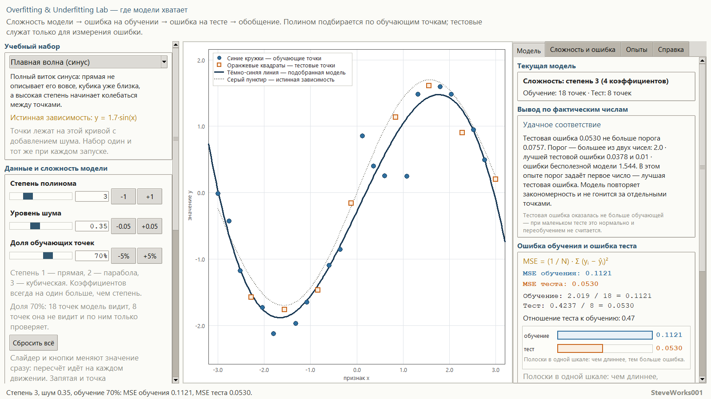
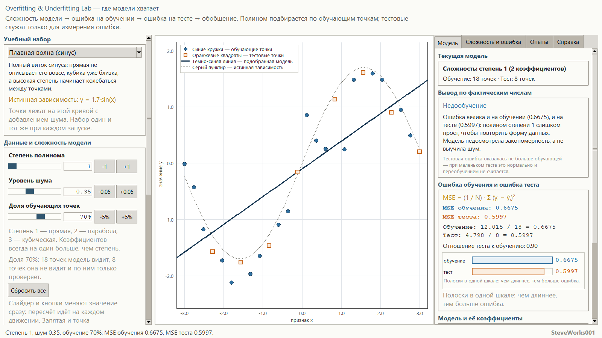
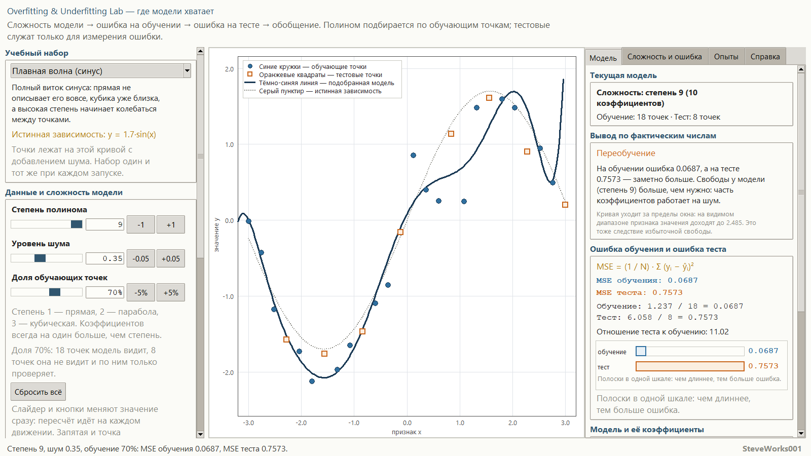
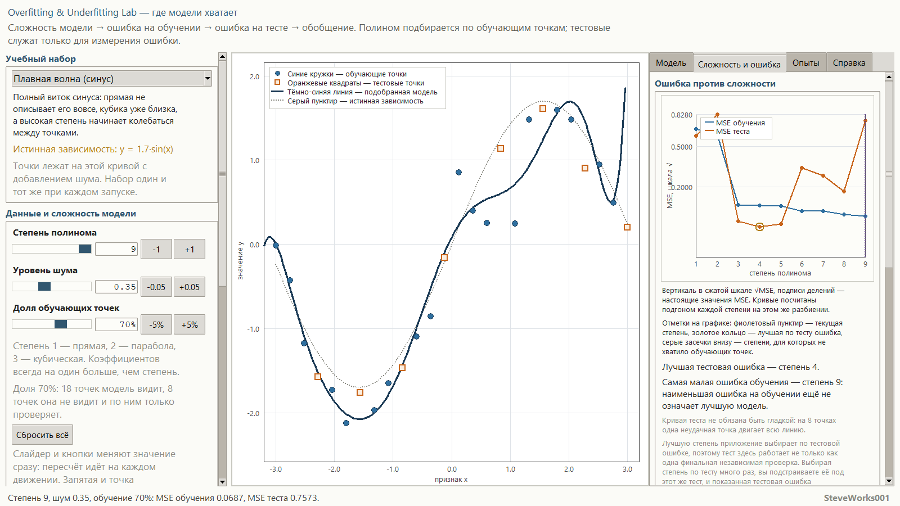
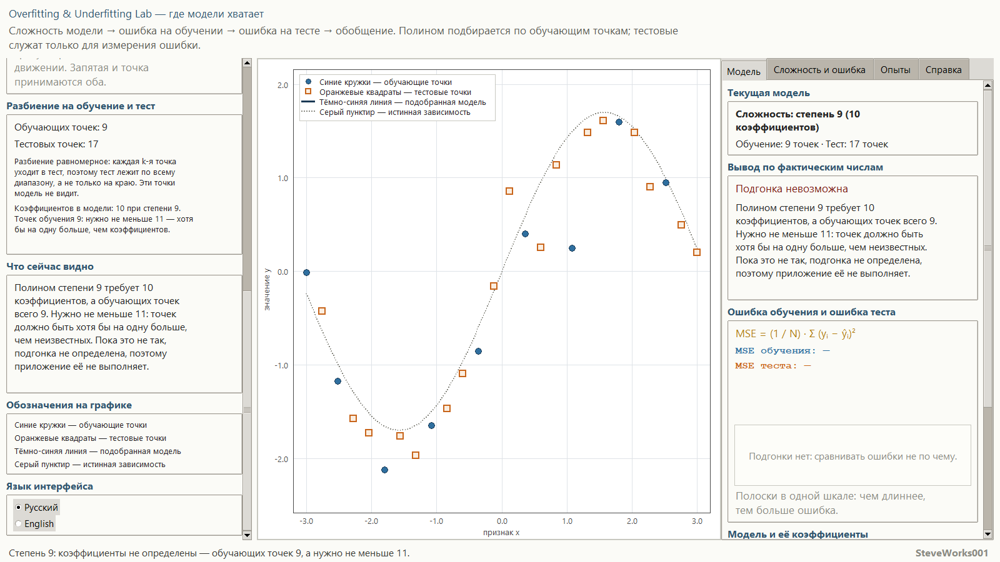
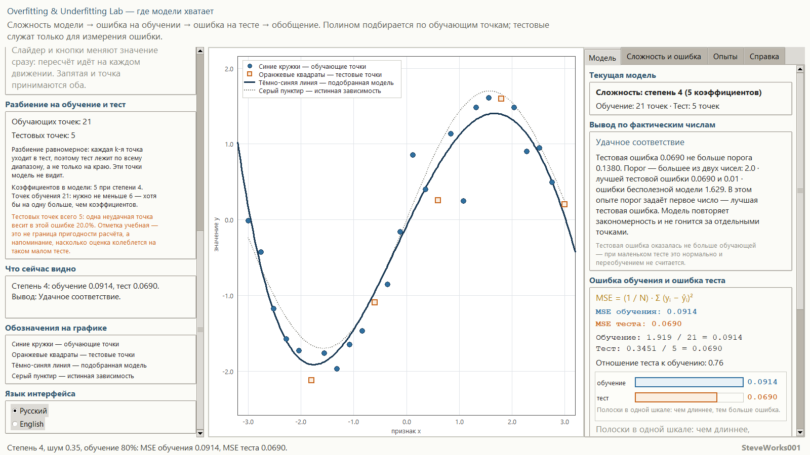
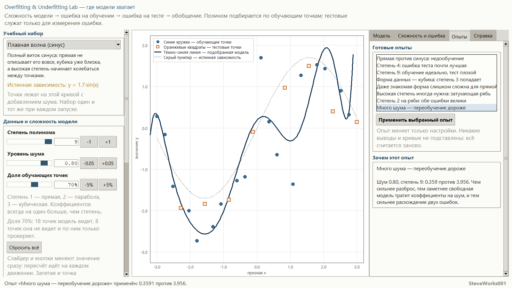
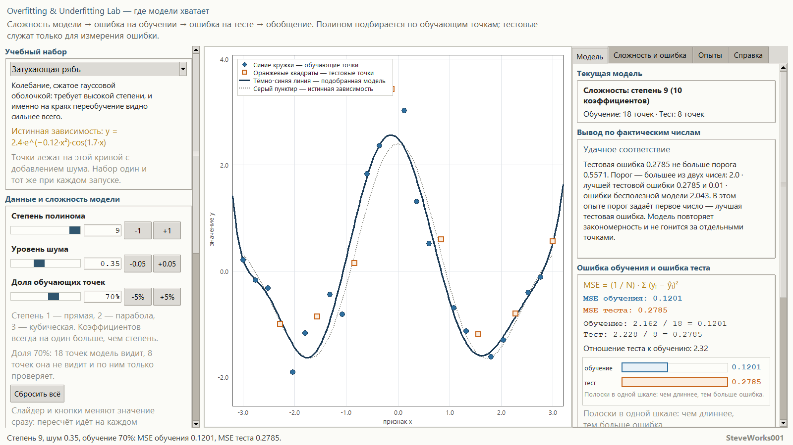
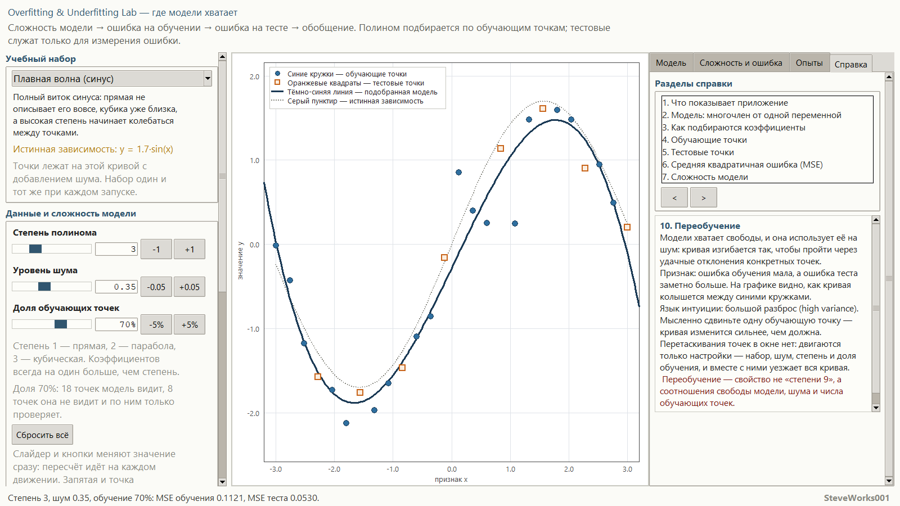
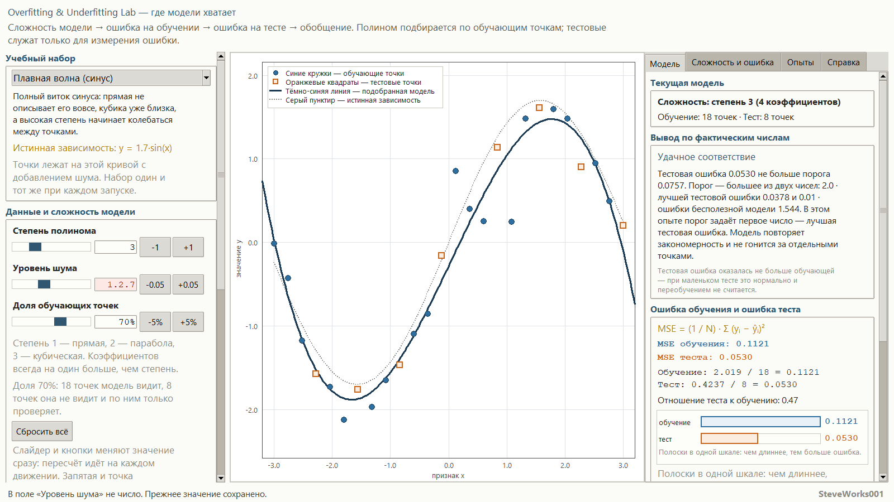

# Overfitting & Underfitting Lab — учебный симулятор переобучения и недообучения

English version: [README_EN.md](README_EN.md).

Проект 10 из 13 серии учебных симуляторов нейронных сетей.
Однофайловое приложение на Python и Tkinter: только стандартная библиотека,
без внешних пакетов, без сети и без установки зависимостей.
Показывает одну цепочку на живом эксперименте: **сложность модели → ошибка на
обучении → ошибка на тесте → обобщение**. Это ровно те четыре звена, что стоят
под заголовком окна. Это не библиотека машинного обучения и не система обучения
нейронных сетей.

Приложение открывается в заранее известном состоянии: набор «Плавная волна
(синус)», степень 3, уровень шума 0.35, доля обучающих точек 70%. Строка состояния
печатает это словами: `Набор «Плавная волна (синус)», степень 3, шум 0.35,
обучение 70%. Обучающих точек 18, тестовых 8.` Стартовое положение — уже готовый
пример удачного соответствия: MSE обучения 0.1121 против MSE теста 0.0530, вывод
«Удачное соответствие». Кнопка «Сбросить всё» возвращает ровно в это состояние.

---

## Назначение

Симулятор отвечает на один вопрос: **когда модели хватает, когда она слишком
стеснена и когда она начинает заучивать шум**. Один и тот же набор точек, одна и
та же модель — многочлен, и меняете вы только три вещи: его степень,
уровень шума и долю обучающих точек. На экране при этом видно, как ошибка на
обучении падает почти всегда, а ошибка на тесте сначала падает, а потом растёт.

Основная цепочка, на которой построен весь интерфейс:

**сложность модели → MSE на обучении → MSE на тесте → вывод о режиме →
обобщение**

В окне цепочка короче — там четыре звена, без «вывода о режиме»: подпись режима
придумана для интерфейса, а не для явления, и подзаголовок окна перечисляет
четыре. Пятое звено добавлено в этом документе намеренно: ниже подробно описано,
как приложение получает подпись режима из рассчитанных чисел, и без этого шага
цепочка обрывается на метриках.

Модель одна и та же везде: точки, кривая, обе ошибки, сравнительные полоски,
таблица по степеням и кривая «ошибка против сложности» считаются из одного и
того же разбиения и одного и того же решения метода наименьших квадратов.
Никаких декоративных линий и никаких заранее заготовленных выводов — приложение
подписывает режим по фактическим ошибкам, а не по значению степени.

### Чего в этом проекте нет

Предыдущие проекты серии показывают обучение и его шаги. Здесь обучения в этом
смысле нет намеренно:

- нет градиентного спуска, эпох и итерационного уточнения коэффициентов —
  многочлен находится одним решением метода наименьших квадратов;
- нет регуляризации (L1, L2) и нет способа «спасти» избыточно сложную
  модель;
- нет кросс-валидации, бутстрапа и повторов на разных разбиениях;
- нет ансамблей, нейронных сетей и нелинейных моделей;
- нет классификации и её метрик: задача — регрессия, ответом является число;
- нет многомерных признаков: признак ровно один, и только поэтому весь эксперимент
  виден на плоскости;
- нет реальных датасетов, загрузки данных и внешних библиотек.

Всё внимание — одному центральному сравнению: что происходит с двумя ошибками,
когда модели становится слишком мало или слишком много.

## Учебные цели

- Понять, что сложность модели — это не абстракция, а число коэффициентов,
  которые модель успевает подстроить под данные.
- Пройти цепочку целиком: сложность → ошибка обучения → ошибка теста → вывод об
  обобщении.
- Различать обучающие и тестовые точки и понимать, почему тестовые не участвуют
  в подгонке ни в каком виде.
- Понять, что низкая ошибка на обучении сама по себе ничего не говорит: её
  всегда надо сравнивать с ошибкой на данных, которые модель не видела.
- Увидеть три режима на одном и том же наборе: недообучение, удачное соответствие
  и переобучение.
- Понять, почему переобучение — это не «высокая степень», а сочетание высокой
  свободы модели и шума в данных.
- Понять, почему недообучение — это не «низкая степень», а ошибка, которая велика
  с обеих сторон.
- Научиться читать кривую «ошибка против сложности» и видеть, что минимум
  тестовой ошибки — это свойство конкретного набора, а не число, которое
  заранее известно.
- Понять, что «правильной» степени не существует: лучшая степень зависит от формы
  данных, уровня шума и размера обучающей выборки.
- Получить интуитивное представление о смещении и разбросе — без формул и без
  доказательств.
- Понять, когда вычисление законно отказывается: когда обучающих точек не больше,
  чем коэффициентов — нужен запас хотя бы в одну точку, — и когда решение теряет
  устойчивость.

## Математика: многочлен и две ошибки

| Понятие | Запись |
|---|---|
| **Модель** | `ŷ = b₀ + b₁x + b₂x² + … + bₙxⁿ` |
| **Число коэффициентов** | `n + 1` при степени `n` |
| **Ошибка на множестве** | `MSE = (1 / N) · Σ (yᵢ − ŷᵢ)²` |
| **Что минимизируется** | та же сумма квадратов, но только по обучающим точкам |
| **Опорная ошибка** | MSE константы «среднее по обучению», проверенной на тесте |
| **Условие решаемости** | обучающих точек должно быть не меньше `n + 2` |
| **Разрыв как признак** | `MSE теста / MSE обучения` |

**Модель.** Степень `n` задаёт свободу: `n = 1` — прямая, `n = 2` — парабола,
`n = 3` — кубическая кривая, и так далее до `n = 9`. Коэффициентов всегда на один
больше, чем степень, и каждый из них модель «тратит» на то, чтобы повторить
данные. При `n = 1` у неё ровно два числа, поэтому виток синуса она описать не
может — при любой подгонке.

**Подгонка.** Коэффициенты находятся методом наименьших квадратов по обучающим
точкам. Расчёт ведётся в ортогональном базисе по степеням нормированной
переменной `t = x / 3`, а готовые коэффициенты пересчитываются к обычным
степеням `x`. Это сделано ради устойчивости: обычные нормальные уравнения для
степеней вплоть до девятой на таких данных теряют точность, а в ортогональном
базисе каждый коэффициент находится отдельным делением. Подобранный многочлен
показывается целиком — общим видом и настоящими числами коэффициентов, чтобы
промежуточные шаги можно было перепроверить вручную.

**Разбиение на обучение и тест.** Точки всегда лежат ровно и равномерно, поэтому
разбиение тоже равномерное: в тест уходит каждая k-я точка, а не последний
кусок диапазона. Иначе тест лежал бы только на краю графика, и вывод о
переобучении зависел бы от края, а не от модели. Точки, попавшие в тест,
полностью исключены из подгонки: решение и обе ошибки считаются так, будто их
не существует. Именно поэтому тестовая ошибка может быть доказательством
обобщения, а не просто ещё одним числом.

**Сколько точек уходит в тест.** Число тестовых точек получается из доли:
`k = округло(26 · (1 − доля))`, после чего оно ограничивается диапазоном `1…n−2`,
то есть `1…24` для 26 точек: тест не может стать пустым, и две обучающие точки
сохраняются при любом значении доли. До ползунка эти границы не доходят — доля
ходит в пределах `35…90%`, и тест получает от 3 до 17 точек, так что `1` и `24`
остаются страховкой формулы, а не достижимым режимом. Примеры: 70% → 8 тестовых и
18 обучающих, 80% → 5 и 21, 90% → 3 и 23, 35% → 17 и 9.

**Две ошибки.** На множестве точек считается среднеквадратичная ошибка: среднее
квадратов отклонений `y − ŷ`. Для обучения она показывает, насколько точно
кривая повторяет те точки, по которым её строили; для теста — насколько она
повторяет точки, которые модель не видела. Обе подписаны одним и тем же знаком,
показаны в одной шкале и сопровождаются суммами квадратов и их отношением,
чтобы число было видно, а не только вывод.

**Опорная ошибка.** Кроме двух ошибок считается ошибка константной модели —
«всегда отвечай средним по обучению». Это шкала «модель ничего не предсказывает».
Без неё маленькая абсолютная ошибка на гладких данных выглядела бы
переобучением, хотя к переобучению она отношения не имеет.

**Как приложение подписывает режим.** Вывод строится по рассчитанным ошибкам, а
не по значению степени, и правило открыто показано в интерфейсе:

1. берётся лучшая тестовая ошибка среди всех степеней этого диапазона;
2. порог «всё ещё хорошо» = максимум из `2 · лучшей тестовой ошибки` и
   `1% опорной ошибки`;
3. тест не хуже порога → удачное соответствие;
4. иначе, если тест хотя бы вдвое хуже обучения и степень не левее лучшей по
   тесту → переобучение;
5. иначе, если степень левее лучшей и разрыва нет → недообучение;
6. иначе → переходный случай: признаки смотрят в разные стороны.

Пороги `2.0`, `2.0` и `1%` — это правила конкретного приложения, а не научные
константы и не рекомендованные значения. Они показаны на вкладке «Сложность и
ошибка» вместе с подставленными числами текущего опыта. Приложение принципиально
не утверждает, что высокая степень всегда хуже, что низкая всегда безопасна, что
тестовая ошибка обязана быть больше обучающей и что для всяких данных существует
одна оптимальная степень.

**Когда подгонки нет.** Если обучающих точек меньше, чем `n + 2`, решение не
определено: одних уравнений по числу неизвестных не хватает, и даже ровно равное
число точек приложение не считает достаточным — нужен запас хотя бы в одну точку
сверх `n + 1` коэффициентов. Если очередной член базиса
оказывается слишком близок к уже учтённым, вычисление теряет устойчивость. В
обоих случаях приложение не рисует подозрительную кривую и не выдаёт
сомнительные коэффициенты — оно отказывает и по-человечески объясняет причину:
не хватило точек или вычисление стало неустойчивым. Отказ — тоже учебный
результат, и он показывается наравне с успешными режимами.

На сетке этого приложения границы отказа проходят так: точек всегда 26, доля 70%
даёт 18 обучающих — их хватает на все степени, поскольку даже девятой нужно 11;
доля 45% даёт 12 — хватает впритык; доля 40% даёт 10, и девятой уже не хватает;
доля 35% даёт 9 — не подгоняются степени 8 и 9, а степень 7 проходит ровно с
запасом в одну точку (8 коэффициентов, 9 точек). Несостоявшиеся степени не
исчезают из виду: на вкладке «Сложность и ошибка» они помечены серыми засечками
внизу графика, а в таблице против них стоит «нет подгонки».

**Смещение и разброс.** Только интуиция, без формул: слишком стесненная модель
не может описать форму даже в принципе — это большое смещение; слишком
свободная модель чувствительна к удачному рисунку выборки — мысленно сдвиньте
одну точку, и кривая ушла бы за ней, — это большой разброс. Перетаскивания точек
в окне нет: двигаются только настройки — набор, шум, степень и доля обучения.
Никакой статистической проверки этих понятий в проекте нет.

## Учебные наборы данных

Абсциссы всегда стоят ровно и равномерно, а отклонения берутся из фиксированного
ряда гауссовых чисел со стандартным отклонением 1 — ряд рисуется один раз по
постоянному семени набора и больше не меняется. Поэтому число на ползунке уровня
шума — стандартное отклонение добавленных отклонений: 0.35 означает разброс с
теоретической `σ = 0.35`, а 0.00 означает ровно истинную зависимость. Набор
один и тот же при каждом запуске, а ползунок шума увеличивает уже существующие
отклонения, а не пересобирает точки заново: шум виден как рост разброса, а не
как новый случайный рисунок. «Истинная зависимость» известна и нарисована
серым пунктиром только для наглядности — в подгонке она не участвует.

| Набор | Точек | Истинная зависимость | Смысл |
|---|---|---|---|
| **Плавная волна (синус)** | 26 | `y = 1.7·sin(x)` | Прямая не описывает виток вовсе, кубика уже близка, а высокая степень начинает колыхаться между точками. |
| **Кубическая S-образная** | 26 | `y = 0.18·x³ − 0.7·x` | Форма — ровно многочлен третьей степени: без шума степень 3 восстанавливает её точно, а степень выше уже лишняя. |
| **Затухающая рябь** | 26 | `y = 2.4·e^(−0.12·x²)·cos(1.7·x)` | Быстрые колебания требуют высокой степени — и именно на этом наборе видно, что «сложная модель» иногда необходима, а переобучение дороже всего стоит на краях. |

Три набора взяты не для разнообразия: на первом удобно видеть все три режима,
второй показывает, что удачное соответствие бывает точным совпадением формы, а
третий разрушает самое частое ложное понимание — будто высокая степень всегда
означает переобучение. При одинаковых настройках (шум 0.35, доля 70%) лучшая по
тесту степень у них разная: 4 на волне, 3 на кубике и 9 на ряби — это первое, что
стоит увидеть в приложении.

## Интерфейс и как пользоваться

- **Слева** (колонка прокручивается) — «Учебный набор» с описанием и формулой
  истинной зависимости; «Данные и сложность модели»: три параметра опыта —
  степень `1…9`, уровень шума `0…0.9` с шагом `0.05`, доля обучающих точек
  `35…90%` с шагом `5%` — для каждого ползунок, поле ввода и кнопки шага, плюс
  кнопка «Сбросить всё»; «Разбиение на обучение и тест» с числом обучающих и
  тестовых точек, числом коэффициентов и требуемым минимумом точек, а при
  маленьком тесте — отдельная отметка о том, сколько веса приходится на одну
  тестовую точку; «Что сейчас видно» с живой строкой
  «степень, обучение, тест, вывод»; «Обозначения на графике» и «Язык
  интерфейса».
- **В центре** — основной график: синие круги — обучающие точки, оранжевые
  квадраты — тестовые, тёмно-синяя линия — подобранный многочлен, серый пунктир
  — истинная зависимость; легенда, сетка и подписи осей. Вертикальный масштаб
  подбирается по данным, а если кривая выходит за видимую область, приложение
  говорит об этом прямо и называет, до каких значений она доходит.
- **Справа** — четыре прокручиваемые вкладки: «Модель», «Сложность и ошибка»,
  «Опыты», «Справка».
- На вкладке «Модель» — «Текущая модель» со степенью, числом коэффициентов и
  числом точек, «Вывод по фактическим числам» с объяснением по рассчитанным
  ошибкам, «Ошибка обучения и ошибка теста» с явными суммами квадратов и их
  отношением и полосками «Сравнение ошибок» в одной шкале, «Модель и её
  коэффициенты» — общий вид многочлена и подобранные коэффициенты с четырьмя
  значащими цифрами.
- На вкладке «Сложность и ошибка» — «Ошибка против сложности»: график двух
  кривых для всех степеней `1…9` на том же разбиении. Вертикальная ось — сжатая
  шкала `√MSE`, но подписи
  делений остаются настоящими значениями MSE, поэтому величину видно честно.
  Золотое кольцо отмечает лучшую по тесту степень, фиолетовый пунктир — текущую,
  серые засечки внизу — степени, для которых не хватило обучающих точек. Ниже —
  «Таблица по всем степеням» с колонками «Степень / MSE обуч. / MSE тест /
  Вывод», «Как приложение получает вывод» с подставленными числами текущего
  опыта, заметка о том, что лучшая степень выбирается по тесту и потому тест
  работает не только как финальная проверка, и «Интуиция: смещение и разброс».
- На вкладке «Опыты» — «Готовые опыты», кнопка «Применить выбранный опыт» и
  панель «Зачем этот опыт» с целью сценария и тем, что в нём нужно увидеть.
- На вкладке «Справка» — «Разделы справки» с кнопками листания `<` и `>`.
- Обычная последовательность: выбрать набор → поставить степень 1 и посмотреть,
  что обе ошибки велики → поднимать степень по одной, следя за тем, как ошибка
  обучения падает, а тестовая сначала падает, а потом растёт → открыть
  «Сложность и ошибка», чтобы увидеть весь диапазон сразу → уменьшить долю
  обучающих точек и увидеть, что те же степени стали опаснее → поставить шум
  `0.00` и увидеть, что без шума лишняя свобода стоит дешевле.
- Ввод с клавиатуры принимает точку и запятую как разделитель, а также
  отрицательные значения. Некорректный ввод приложение не роняет: поле
  подсвечивается, в статусной строке появляется понятное сообщение, а предыдущее
  допустимое значение сохраняется. Значение вне диапазона не отбрасывается молча —
  показывается, какой у поля диапазон и какое значение взято вместо введённого.

Интерфейс полностью доступен на русском и английском и переключается без
перезапуска; текущее состояние — набор, степень, шум, доля обучающих точек,
активная вкладка, выбранный опыт и раздел справки — при переключении языка
сохраняется.

## Готовые опыты

Одиннадцать сценариев, каждый меняет набор, шум, разбиение и степень и объясняет
одно конкретное поведение:

1. Прямая против синуса: недообучение;
2. Степень 4: ошибка теста почти лучшая;
3. Степень 9: обучение идеально, тест плохой;
4. Форма данных — кубика: степень 3 попадает;
5. Даже знакомая форма слишком сложна для прямой;
6. Высокая степень иногда нужна: затухающая рябь;
7. Степень 2 на ряби: обе ошибки велики;
8. Много шума — переобучение дороже;
9. Шум выключен: кривая почти совпадает с истиной;
10. Мало обучающих точек — кривая улетает;
11. Степень 9 на девяти точках: подгонки нет.

Сам опыт не содержит заготовленного вывода: приложение подписывает режим по
рассчитанным ошибкам, поэтому, изменив степень или шум внутри того же сценария,
вы получите честный пересчёт, а не повтор прежней надписи.

## Справка

Пятнадцать коротких разделов: что показывает приложение, модель-многочлен, как
подбираются коэффициенты, обучающие точки, тестовые точки, средняя квадратичная
ошибка, сложность модели, недообучение, удачное соответствие, переобучение,
обобщение, смещение и разброс (только интуиция), как приложение подписывает
режим, как работать с симулятором и границы метода. Формулы приведены там, где
без них не обойтись; полный учебник в приложение не встраивается.

## Учебные опыты

Пять опытов состоят из действий, которые этот интерфейс действительно позволяет, и
из чисел, которые приложение печатает по этим действиям. Готовые сценарии вкладки
«Опыты» описаны отдельным разделом «Готовые опыты»; здесь всё делается вручную, а
начать любой опыт заново можно кнопкой «Сбросить всё».

**1. Весь диапазон степеней на стартовом наборе.** Действие: оставьте набор
«Плавная волна (синус)», шум 0.35 и долю 70% и поднимайте степень с 1 до 9,
смотря вкладку «Сложность и ошибка».
Наблюдайте: «Таблица по всем степеням» даёт строки — 1: обучение 0.6675, тест
0.5997, «недообучение»; 2: 0.6060 и 0.8280, «недообучение»; 3: 0.1121 и 0.0530,
«хорошо»; 4: 0.1077 и 0.0378, «хорошо» и золотое кольцо; 5: 0.1074 и 0.0443,
«хорошо»; 6: 0.0858 и 0.3255, «переобучение»; 7: 0.0856 и 0.2684; 8: 0.0732 и
0.1750; 9: 0.0687 и 0.7573, «переобучение». Ошибка обучения убывает почти
монотонно, тестовая — нет: у степени 9 она хуже, чем у 6, 7 и 8. Порог «всё ещё
хорошо» на этом опыте `max(2.00 · 0.0378, 1% · 1.544) = 0.0757`. На стартовой
же степени 3 вкладка «Модель» добавляет строку «Тестовая ошибка оказалась не
больше обучающей — при маленьком тесте это нормально и переобучением не
считается», потому что 0.0530 меньше 0.1121.
О чём подумать: почему степень 8 с тестом 0.1750 подписана «переобучение», хотя её
тест лучше, чем у степени 9, и что именно сравнивает эта подпись — два числа или
две степени.

**2. Лучшая степень — свойство набора.** Действие: не меняя шума 0.35 и доли 70%,
переберите три набора и на каждом откройте вкладку «Сложность и ошибка».
Наблюдайте: золотое кольцо стоит на степени 4 — это набор «Плавная волна
(синус)» (тест 0.0378), на степени 3 — «Кубическая S-образная» (0.1715), на
степени 9 — «Затухающая рябь» (0.2785). Пороги в этих трёх опытах разные —
0.0757, 0.3431 и 0.5571, — потому
что различна и ошибка бесполезной модели: 1.544, 1.173 и 2.043. Степень 9 на ряби
даёт «Удачное соответствие», хотя та же степень, тот же шум и та же доля на волне
дают «Переобучение» с тестом 0.7573.
О чём подумать: что именно отличает эти два случая, если число коэффициентов
одинаково, и какой ложный урок разрушает третий набор.

**3. Шум — второе слагаемое переобучения.** Действие: степень 9, набор «Плавная
волна (синус)», доля 70%; поставьте шум 0.00, а затем 0.80.
Наблюдайте: при шуме 0.00 степень 9 даёт MSE обучения 1.4e-11 и MSE теста 9.4e-10
— это лучшая тестовая ошибка всего диапазона, вывод «хорошо». При шуме 0.35 те же
18 точек дают 0.0687 против 0.7573 и вывод «Переобучение». При шуме 0.80 — 0.3591
против 3.956, а лучшей тестовой степенью остаётся 4 с ошибкой 0.1838. Меняются
только два числа в строке состояния, а вывод меняется на противоположный.
О чём подумать: если без шума та же самая степень безвредна, то что именно модель
запоминает в переобученном случае и почему сложность сама по себе ничего не
объясняет.

**4. Мало обучающих точек: опаснее, а потом отказ.** Действие: набор «Плавная
волна (синус)», шум 0.35, степень 9; уменьшайте долю обучающих точек с 70% до 35%
шагами по 5% и следите за статусной строкой.
Наблюдайте: до 45% (12 обучающих точек) подгонка проходит, хотя девятой нужно 11.
При 40% (10 точек) она уже не определена, а при 35% (9 точек) статус говорит
`Степень 9: коэффициенты не определены — обучающих точек 9, а нужно не меньше 11.`
Поставьте степень 7 на тех же 35%: подгонка проходит ровно с запасом в одну точку
(8 коэффициентов, 9 точек) и даёт обучение 0.0164 против теста 11.005 —
«Переобучение». На вкладке «Сложность и ошибка» степени 8 и 9 помечены серыми
засечками, а в таблице против них стоит «нет подгонки».
О чём подумать: чем отказ отличается от переобучения — в одном случае числу
нельзя доверять, в другом число честное, но большое, — и почему запас в одну точку
сверх числа коэффициентов не является формальностью.

**5. Маленький тест: одна точка двигает всю оценку.** Действие: набор «Плавная
волна (синус)», шум 0.35, доля 80% — тестовых точек становится пять.
Наблюдайте: левая панель добавляет отметку «Тестовых точек всего 5: одна неудачная
точка весит в этой ошибке 20.0%…». Таблица степеней: 3 → 0.0975 и 0.1049
«хорошо»; 4 → 0.0914 и 0.0690 «хорошо» и золотое кольцо; 6 → 0.0831 и 0.1269 всё
ещё «хорошо»; 7 → 0.0830 и 0.1547 «переход»; 8 → 0.0783 и 0.1400 «переход»;
9 → 0.0705 и 1.890 «переобучение». Порог: `max(2.00 · 0.0690, 1% · 1.629) =
0.1380`.
О чём подумать: те же степени 7 и 8 на восьми тестовых точках дали 0.2684 и 0.1750
с выводом «переобучение», а на пяти — 0.1547 и 0.1400 с «переходом»; чем
объясняется эта мягкость и чего стоит ожидать от вывода, посчитанного по пяти
точкам.

## Установка и запуск

Приложение не нужно ни устанавливать, ни собирать — достаточно запустить один файл.

Windows:

```bash
python overfitting_underfitting_lab.py
```

macOS и Linux:

```bash
python3 overfitting_underfitting_lab.py
```

Аргументы командной строки, внешние данные и файлы настроек не нужны: наборы
точек, параметры и все тексты интерфейса лежат в самом файле. Быстрый старт:
приложение открывается на наборе «Плавная волна (синус)» со степенью 3, шумом 0.35
и долей 70%, статусная строка печатает `Набор «Плавная волна (синус)», степень 3,
шум 0.35, обучение 70%. Обучающих точек 18, тестовых 8.`, а на вкладке «Модель»
уже видно удачное соответствие — 0.1121 на обучении против 0.0530 на тесте.
Откройте «Сложность и ошибка», чтобы увидеть весь диапазон степеней на этом же
разбиении. На вкладке «Опыты» по умолчанию ничего не выбрано, и панель читает
«Выберите опыт из списка — он переставит набор, степень, шум и разбиение, а числа
пересчитаются по-настоящему»; нажатие «Применить выбранный опыт» без выбора
отвечает «Сначала выберите опыт в списке».

Окно открывается примерно от `1240×780` (на типичном экране — около 90 % ширины и
88 % высоты) и не уменьшается примерно ниже `1288×640`; на невысоком дисплее нижняя
граница автоматически меньше экрана. Ширина 1288 диктуется самим макетом:
минимальные ширины трёх колонок — 336, 420 и 436 пиксела, и с полями меньше они не
умещаются, поэтому обреза нет: боковая колонка и вкладки прокручиваются.
Приложение просит оконный менеджер развернуть окно, но часть менеджеров отказывает
— тогда размер задают вручную. Очень узкие окна ухудшают читаемость интерфейса.

## Скриншоты

Снимки сделаны из реально запущенного окна размером 1600×900 пикселов. Русская и
английская серии показывают одни и те же состояния, поэтому кадры можно
сравнивать построчно: цифры в подписях — те, что приложение напечатало в момент
съёмки.

**Стартовое состояние — удачное соответствие.** Набор «Плавная волна (синус)»,
степень 3, шум 0.35, доля 70%: 18 обучающих и 8 тестовых точек, MSE обучения
0.1121 против 0.0530 на тесте, вердикт «Удачное соответствие».



**Недообучение: степень 1.** Те же настройки, степень опущена до 1: ошибки велики
с обеих сторон — 0.6675 на обучении и 0.5997 на тесте, вердикт «Недообучение».



**Переобучение: степень 9.** Ошибка обучения упала до 0.0687, а тестовая выросла
до 0.7573: кривая дрожит между точками, вердикт «Переобучение».



**Вкладка «Сложность и ошибка».** Две кривые по всем степеням 1…9 на том же
разбиении: золотое кольцо отмечает лучшую тестовую степень 4, фиолетовый пунктир —
текущую степень 9. Под графиком подписано, что наименьшая ошибка на обучении ещё
не означает лучшую модель.



**Отказ: обучающих точек не хватает.** Доля 35% оставляет 9 обучающих точек, а
для степени 9 нужно не меньше 11. Кривая не нарисована, коэффициенты не показаны,
обе ошибки прочеркнуты, панель вывода читает «Подгонка невозможна»; левая колонка
прокручена к блоку «Разбиение на обучение и тест», где видно 9 и 17 точек.



**Маленький тест: одна точка весит много.** Доля 80% — 21 обучающая и 5 тестовых
точек, степень 4 даёт 0.0914 против 0.0690. В прокрученной левой колонке видно
отдельную пометку о том, что одна неудачная точка весит в тестовой ошибке 20.0%.



**Вкладка «Опыты» с применённым сценарием.** Опыт «Много шума — переобучение
дороже» переставил степень на 9 и шум на 0.80: 0.3591 на обучении против 3.956 на
тесте — вердикт пересчитан по этим числам, а не взят из заготовки.



**Высокая степень иногда нужна.** Набор «Затухающая рябь», степень 9, шум 0.35,
доля 70%: 0.1201 на обучении и 0.2785 на тесте, вердикт «Удачное соответствие» —
лучшая тестовая степень здесь и есть 9.



**Раздел справки о переобучении.** Вкладка «Справка», раздел «10. Переобучение».



**Отказ на нечисловой ввод.** В поле «Уровень шума» набрано `1.2.7`: поле
подсвечено, статусная строка читает «В поле «Уровень шума» не число. Прежнее
значение сохранено.», шум остался 0.35 — значение не сбросилось и не стало
нулевым.



## Требования

- Python 3.8 или новее.
- Tkinter — входит в официальные сборки Python для Windows и macOS; в некоторых дистрибутивах
  Linux ставится отдельно как пакет `python3-tk`.
- Только стандартная библиотека: `math`, `random`, `tkinter`, `tkinter.ttk`,
  `tkinter.font`.
- Не используются: NumPy, pandas, SciPy, matplotlib, scikit-learn и сторонние
  GUI-фреймворки.
- Сетевое соединение для работы приложения не требуется.

## Ограничения

- Модель — один многочлен от одного признака: ни нескольких признаков, ни других
  семейств моделей, ни сравнения семейств между собой.
- Степень ограничена диапазоном `1…9`; за его пределами ничего не считается и
  не рисуется.
- Набор всегда один и тот же и состоит из 26 точек: он показывает геометрию
  задачи, а не статистику реальной выборки.
- Разбиение одно за раз: поменять состав тестовых точек можно только через долю
  обучающих точек, а не явным списком.
- Вывод — чтение конкретных рассчитанных ошибок на конкретной выборке. Это
  учебное суждение, а не статистическая проверка гипотез.
- Пороги `2.0`, `2.0` и `1%` выбраны ради наглядности и показаны в интерфейсе;
  они не всеобщие и не заменяют кросс-валидацию.
- Нет повторов на разных разбиениях и разных выборках, поэтому разброс оценки
  показан только как интуиция, а не как измеренная величина.
- При маленьком тесте одна тестовая точка весит очень много: при пяти точках и
  меньше каждая из них даёт не менее пятой части тестовой ошибки, поэтому
  приложение отмечает такое разбиение отдельной пометкой. Это учебная
  ориентировка, а не граница пригодности: посчитать ошибку можно и при двух
  точках, просто она будет почти целиком зависеть от одной из них.
- Если подбирать степень по тестовой ошибке, тест перестаёт быть независимой
  проверкой: показанная тестовая ошибка начинает оптимистично недооценивать
  будущую ошибку на новых данных. В этом симуляторе это осознанный приём — так
  видно лучшую степень, — но в реальной задаче для этого нужен отдельный
  валидационный набор.
- Нет регуляризации: единственный рычаг против переобучения — снизить степень
  или увеличить долю обучающих точек.
- Истинная зависимость известна и нарисована только для наглядности; в реальной
  задаче её нет, поэтому «настоящая ошибка формы» здесь доступна, а в практике —
  нет.
- При неопределённом или неустойчивом вычислении приложение отказывается считать
  и объясняет причину: вместо отказа можно было бы нарисовать кривую, но она
  была бы неверной.

## Учебная оговорка

Симулятор предназначен для того, чтобы увидеть и запомнить связь «сложность
модели — две ошибки — обобщение». Часть соглашений выбрана ради наглядности и
может отличаться от принятых в конкретной библиотеке машинного обучения: например,
равномерное разбиение вместо случайного, MSE как единственная метрика, границы
диапазона степени и сами пороги вывода. Переносить эти соглашения в реальную
модель нужно осознанно: вывод здесь держится на одной конкретной выборке, а
устойчивое и честное суждение об обобщении требует повторов и отдельной
проверки.

## Что нужно знать заранее

**Строго необходимо:** Python 3 с Tkinter и запуск одного файла из командной
строки. Пакеты из `pip`, сеть, внешние данные и файлы настроек не нужны.

**Математика:** умение подставить числа в `b₀ + b₁x + b₂x² + … + bₙxⁿ` и
понимание, что такое среднее арифметическое и квадрат отклонения. Производные,
интегралы и матрицы не используются: коэффициенты находятся ортогонализацией
базиса, а приложение показывает и общий вид многочлена, и все его коэффициенты,
так что подстановкой проверяется любой шаг. Понятия производной и градиента здесь
нет вовсе — это отличие от проектов 4, 5, 6 и 11 содержательное, а не косметическое.

**Полезно, но не обязательно:** проект 8 «Функции потерь» — там MSE появляется как
штраф за одно предсказание; проект 6 «Обучение нейронной сети» — там ошибка
растянута по шагам обучения, а разбиения на обучение и проверку нет вовсе; проект
9 «Классификация» — там ответом является метка класса. Ни один из них не нужно
проходить заранее, чтобы открыть это приложение.

**О версии Python:** раздел «Требования» называет Python 3.8 или новее.
Приложение версию не проверяет, а запуск на других версиях не тестировался —
это объявленная совместимость, а не проверенная гарантия.

## Место в серии

Проект 10 из 13. Порядок не строгий: каждый проект запускается сам по себе и
ничего не читает из соседних. Ниже только те связи, которые есть по содержанию.

| Проект | Связь по содержанию |
|---|---|
| 3 — Mini Neural Network | там веса назначаете вы и виден один проход вперёд; здесь коэффициенты находятся из точек, но не итерациями |
| 4 — Gradient Descent | там минимум функции шагами по производной; здесь минимум той же суммы квадратов получается одним решением |
| 6 — Neural Network Training | там ошибка пишется по эпохам обучения, а разбиения на обучение и проверку нет; здесь разбиение и есть главный предмет |
| 8 — Loss Functions | там MSE — функция потерь с множителем 1/2 у одного предсказания; здесь та же сумма квадратов усреднена по множеству и служит мерой, а не штрафом |
| 9 — Classification | там ответ — метка класса и метрика accuracy; здесь ответ — число, и доля верных ответов к нему неприменима |
| 11 — Optimizers | там сравнивают скорости сходимости на заданной цели; здесь сходиться нечему: решение находится за один шаг |
| 13 — Multiclass Softmax | там одна метка выбирается максимумом из нескольких оценок; здесь выбора нет, есть только отклонение от кривой |

## Разработчик

**Разработчик: SteveWorks001**

## Лицензия

Проект распространяется под лицензией MIT; полный текст лежит в файле
[LICENSE](LICENSE).
